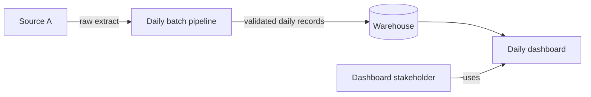

# Architecture

## System context (C2)

Current proposal for the capstone; update the diagram as implementation and
source access are confirmed. The daily batch choice is recorded in
[ADR 0001](decisions/0001-batch-or-streaming.md).

**Open decisions:** source delivery and access, warehouse technology, runtime
orchestration, reporting timezone, and the dashboard stakeholder's freshness
target.